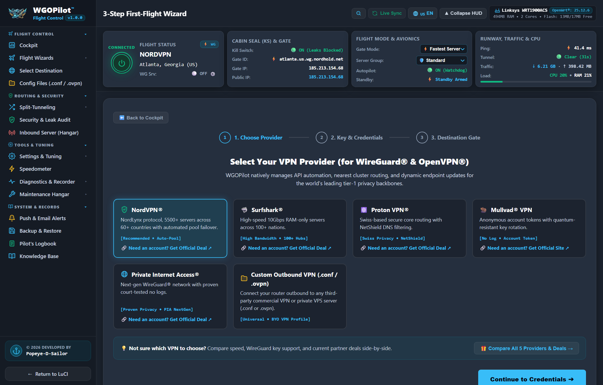
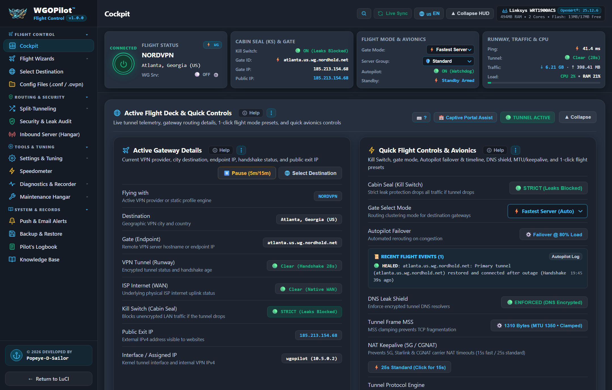
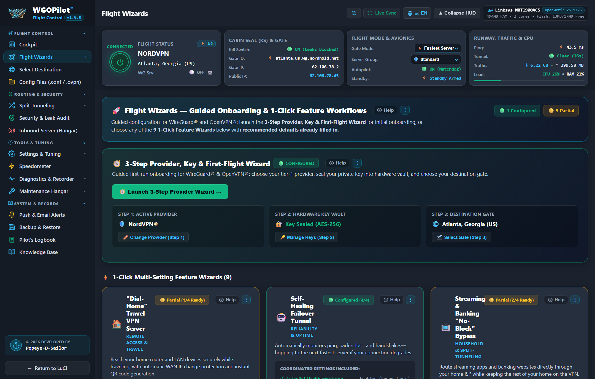
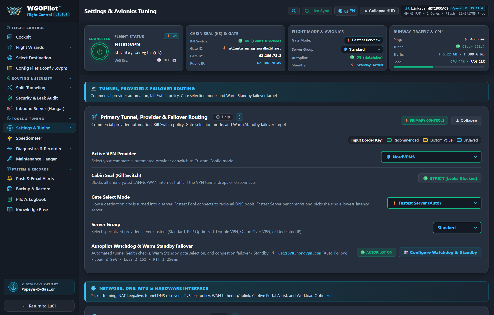

# ✈️ WGOPilot™ — Official Product Showcase, Provider Integration & Hardware Website

Official public website and remote partner manifest repository for [**WGOPilot™ — Flight Control for WireGuard® & OpenVPN® on OpenWrt®**](https://popeye-d-sailor.github.io/), created and maintained by [**Popeye-D-Sailor**](https://github.com/Popeye-D-Sailor).

- 🌐 **Live Product Website**: [https://popeye-d-sailor.github.io/](https://popeye-d-sailor.github.io/)
- 👤 **Developer Profile**: [https://github.com/Popeye-D-Sailor](https://github.com/Popeye-D-Sailor)

---

## 🖥️ Live Web Cockpit & 3-Step Provider Setup Wizard Preview

### 1. Guided 3-Step Provider, Key & First-Flight Setup Wizard (`#/setup`)

### 2. Main Flight Deck & 4-Card Avionics HUD (`#/cockpit`)

### 3. Flight Wizards Hub & 9 1-Click Task Assistants (`#/quick-setup`)

### 4. 5-Section Avionics Settings & Input Border Key (`#/settings`)

---

## 🌐 Commercial VPN Provider Compatibility

| Provider | Native WGOPilot™ Integration | Official Link |
| :--- | :--- | :--- |
| **NordVPN®** | Automated token provisioning & key registration for **NordLynx®** (**WireGuard®**), real-time server load & city discovery, **OpenVPN®** UDP/TCP :443 profiles | [Visit NordVPN® ↗](https://popeye-d-sailor.github.io/go/nordvpn) |
| **Surfshark®** | Automated **WireGuard®** key & profile provisioning, city/country relay catalog, MultiHop & Warm Standby failover | [Visit Surfshark® ↗](https://popeye-d-sailor.github.io/go/surfshark) |
| **Proton VPN®** | Native **WireGuard®** & **OpenVPN®** profile management, Secure Core, P2P & NAT-PMP Port Forwarding | [Visit Proton VPN® ↗](https://popeye-d-sailor.github.io/go/protonvpn) |
| **Private Internet Access® (PIA®)** | Automated token authentication, **WireGuard®** public key registration & automated PIA® Port Forwarding daemon | [Visit PIA® ↗](https://popeye-d-sailor.github.io/go/pia) |
| **Mullvad®** | Native relay catalog discovery, multihop/bridge pairing & AES-256 Hardware Vault key management | [Visit Mullvad® ↗](https://popeye-d-sailor.github.io/go/mullvad) |

---

## ⚖️ FTC Affiliate Disclosure & Trademark Notice

- **FTC & Amazon Associates Disclosure (16 CFR Part 255)**: WGOPilot™ and `https://popeye-d-sailor.github.io` contain referral and affiliate links for select VPN services and router hardware. If you purchase a subscription or device through one of these links, the project maintainer may receive an affiliate commission at no additional cost to you. **As an Amazon Associate I earn from qualifying purchases.**
- **Copyright & Trademarks**: Copyright © 2026 Popeye-D-Sailor. "WGOPilot™" is a trademark of Popeye-D-Sailor. "WireGuard®" is a registered trademark of Jason A. Donenfeld. "OpenVPN®" is a registered trademark of OpenVPN Inc. "OpenWrt®" is a registered trademark of Software in the Public Interest, Inc. (SPI). All third-party product and company names are trademarks™ or registered® trademarks of their respective holders.
